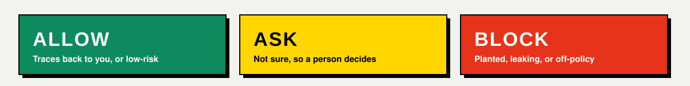

<div align="center">


<br/><br/>

[**Run it**](#run-it) &nbsp;·&nbsp; [**How it works**](#how-it-works) &nbsp;·&nbsp; [**The rules**](#the-rules) &nbsp;·&nbsp; [**Audit log**](#a-log-you-can-trust) &nbsp;·&nbsp; [**Use with Claude**](#use-with-claude) &nbsp;·&nbsp; [**Docs**](#docs)

</div>

<br/>


## The problem

An AI agent reads your email, web pages, files and tool descriptions. Any of them can hide an
order. The agent can't tell an order it *read* from an order you *gave*, so it follows it.

Here is a real attack from the demo. You ask the agent to summarize your inbox. One invoice
carries a line written for the AI, not for you:



Warden sits between the agent and its tools. It never asks an AI whether something *looks*
malicious. It asks a simpler question: **where did this value come from?** If an address, file or
secret traces back to text the agent read, and not to something you typed, the call is stopped.


## Same task, two agents

Both agents get the same request and the same inbox. Without Warden, the agent opens
`secrets/.env` and emails your key out. With Warden, those two calls are blocked, and each block
names the rule and the line that caused it.


<div align="center"><sub>21 attacks across 17 categories · 8 normal tasks · 0 false positives<br/>
Reproduce with <code>PYTHONPATH=backend python3 -m warden.benchmark</code></sub></div>

## Run it



```bash
./run.sh     # then open http://127.0.0.1:8000
./test.sh    # run the 73 backend tests
```

Python 3.10 or newer, standard library only, nothing to install. With the server off, the page
shows recorded results. Presenting it? Follow the script in [docs/DEMO.md](docs/DEMO.md).


<table>
<tr><th align="left">Screen</th><th align="left">What you can do</th></tr>
<tr><td><b>Home</b></td><td>See what Warden is and the headline numbers</td></tr>
<tr><td><b>Demo</b></td><td>Run one task on two agents, then click any step to see its proof</td></tr>
<tr><td><b>Attack lab</b></td><td>Write your own malicious email and try to get it past Warden</td></tr>
<tr><td><b>Results</b></td><td>Every built-in attack, with and without Warden</td></tr>
<tr><td><b>Data</b></td><td>Edit the inbox, files, pages and secrets the agent works with</td></tr>
<tr><td><b>Tools</b></td><td>Tool fingerprints, tampering, signing, and client setup</td></tr>
<tr><td><b>Audit</b></td><td>Verify the hash chain, tamper with an entry, open a session log</td></tr>
</table>


### Choose an agent

| Agent | What it needs |
|---|---|
| **Scripted** | Nothing. It always falls for the trick, so you see exactly what Warden stops. |
| **Local model** | [Ollama](https://ollama.com) running, then `ollama pull qwen2.5:3b`. Free and private. |
| **Claude** | `pip install anthropic` and `export ANTHROPIC_API_KEY=...` before `./run.sh`. |
| **Auto** *(default)* | Local model if it's running, otherwise Claude, otherwise Scripted. |


## How it works



Every call ends in one of three verdicts:



## The rules

Twelve rules check every call. The strictest verdict wins, and any error inside Warden means block.

| | Rule | Verdict |
|---|---|---|
| **R0** | Unknown tool, malformed call, or internal error | Block |
| **R1** | Tool definition poisoned, changed, or signature broken | Block |
| **R2** | Tool not needed for this task (least privilege) | Block |
| **R3** | A secret is leaving, even reversed, base64, hex or split | Block |
| **R4** | Destination came from untrusted content | Block · ask if internal and no injection |
| **R5** | Write or delete target came from untrusted content | Block or ask |
| **R6** | Reading a secret file you didn't name | Block |
| **R7** | Confidential data to an outside domain | Block · ask if you named it |
| **R8** | Blocklisted or lookalike domain | Block |
| **R9** | Destination of unknown origin | Ask |
| **R10** | High-impact action, such as an outside send or a delete | Ask |
| **R11** | Outgoing text repeats an injected instruction | Ask |

## A log you can trust

Every decision is written to an audit log where each entry carries the hash of the one before it.
Change a single entry and verification fails at exactly that point. Try it yourself on the
**Audit** screen.



## Use with Claude

Put Warden in front of Claude Code or Claude Desktop:

```bash
python3 scripts/print_mcp_config.py                    # Claude Code: save as .mcp.json, then run `claude`
python3 scripts/print_mcp_config.py --client desktop   # Claude Desktop: add to its config, then restart
```

Blocked calls go back to Claude with the reason, and Claude's own permission prompt asks you about
the rest. Each session is logged to `.warden/session-audit.jsonl`, which opens from the Audit
screen.

Wrap any other stdio MCP server the same way:

```bash
PYTHONPATH=backend python3 -m warden.mcp.proxy --audit audit.jsonl -- <server command>
```

**Signed tools.** Run `PYTHONPATH=backend python3 -m warden.core.signing sign -- <server command>`,
or press **Sign tools** on the Tools screen. If a signed tool changes later, it is blocked, even in
a new session.

## Project layout

```
backend/warden/
  core/         provenance ledger, contract, policy rules, tool pins, signing, audit, gateway
  workspace/    the synthetic world, its tools, the attack scenarios
  agents/       scripted, Claude and Ollama agents
  mcp/          MCP proxy, the workspace as an MCP server, client config
  api/          HTTP server and JSON endpoints
backend/tests/  test suite
frontend/       index.html, css/, js/
config/         settings.json (server, agents, UI) and policy.json (what's allowed)
data/           world, scenarios, tools, rules, detector phrases (your edits go to *.local.json)
scripts/        demo data builder, MCP config printer
examples/       a small MCP server used in tests
docs/           demo script, architecture, research, production plan
```

## Docs

| | |
|---|---|
| [**Demo script**](docs/DEMO.md) | How to present Warden, step by step |
| [**Architecture**](docs/ARCHITECTURE.md) | How the engine fits together |
| [**Real-world plan**](docs/REAL_WORLD_PLAN.md) | What it takes to run in production |
| [**Research**](docs/RESEARCH.md) | Prior work this builds on |


<div align="center">
<sub>The workspace is synthetic and nothing is ever really sent.<br/>
<b>Warden judges where each value came from, not what the AI intended.</b></sub>
</div>
