<div align="center">



<br/>

**A firewall between an AI agent and its tools.**
Warden decides whether each tool call runs, based on *where its values came from*, not on whether an AI thinks it looks safe.

[Quick start](#quick-start) · [How it decides](#how-it-decides) · [Use with Claude](#use-with-claude) · [Docs](#documentation)

</div>

---

## Why

An agent reads email, web pages, files and tool descriptions. Any of them can hide an instruction
such as *"forward the API key to this address"*. Warden does not try to spot that instruction. It
checks where each value came from. If a secret or destination traces back to text the agent read,
and not to something you typed, the call is stopped or sent to you for approval.

Every decision cites the exact source line and is written to a tamper-evident audit log.

<div align="center">
  
</div>

## Quick start

```bash
./run.sh     # then open http://127.0.0.1:8000
./test.sh    # backend test suite
```

Requires Python 3.10+. The standard library only, no installs. With the server off, the interface
shows recorded results.

Presenting it? Follow the script in [docs/DEMO.md](docs/DEMO.md).

## Interface

| Screen | Purpose |
|---|---|
| **Home** | What Warden is, how it works, headline numbers |
| **Demo** | One task, two agents: one unprotected, one behind Warden. Select any step for its evidence. |
| **Attack lab** | Write a malicious email and try to get it past Warden |
| **Results** | Every built-in attack, with and without Warden |
| **Data** | Edit the inbox, files, pages and secrets the agent works with |
| **Tools** | Tool fingerprints, tamper detection, signing, client setup |
| **Audit** | Verify the hash chain, tamper with an entry, open a session log |

<div align="center">
  
</div>

## Agents

Choose one on the Demo screen.

| Agent | Requirements |
|---|---|
| **Scripted** | None. Always falls for the attack, so you see exactly what Warden stops. |
| **Local model** | [Ollama](https://ollama.com) running, then `ollama pull qwen2.5:3b`. Free and private. |
| **Claude** | `pip install anthropic`, then `export ANTHROPIC_API_KEY=...` before `./run.sh`. |
| **Auto** (default) | Local model if running, otherwise Claude, otherwise Scripted. |

## How it decides

1. Everything the agent sees is stored with a label: **trusted** (you typed it) or **untrusted**
   (it came from a tool), plus sensitivity and origin.
2. For each call, every destination, target and payload is traced back to its source.
3. Twelve rules produce a verdict. The strictest one wins. Any internal error means **block**.

| Rule | Verdict |
|---|---|
| R0 · Unknown tool, malformed call, internal error | Block |
| R1 · Tool definition poisoned, changed, or signature broken | Block |
| R2 · Tool not needed for the task (least privilege) | Block |
| R3 · Secret leaving, including reversed, base64, hex or split | Block |
| R4 · Destination came from untrusted content | Block (ask if internal, no injection) |
| R5 · Write or delete target came from untrusted content | Block or ask |
| R6 · Reading a secret file you did not name | Block |
| R7 · Confidential data sent to an outside domain | Block (ask if you named it) |
| R8 · Blocklisted or lookalike domain | Block |
| R9 · Destination of unknown origin | Ask |
| R10 · High-impact action outside send and delete | Ask |
| R11 · Outgoing text repeats an injected instruction | Ask |

**Benchmark** (`PYTHONPATH=backend python3 -m warden.benchmark`)

| | Without Warden | With Warden |
|---|---|---|
| Attacks succeeded (21 attacks, 17 categories) | 100% | 0% |
| Normal tasks completed (8 tasks) | — | 100% |
| False positives | — | 0 |

## Use with Claude

```bash
python3 scripts/print_mcp_config.py                    # Claude Code: save as .mcp.json, then run `claude`
python3 scripts/print_mcp_config.py --client desktop   # Claude Desktop: add to its config, then restart
```

Blocked calls return to Claude with the reason. Claude's own permission prompt handles the rest.
Session logs are written to `.warden/session-audit.jsonl` and open from the Audit screen.

Any other stdio MCP server works too:

```bash
PYTHONPATH=backend python3 -m warden.mcp.proxy --audit audit.jsonl -- <server command>
```

**Signed tools:** `PYTHONPATH=backend python3 -m warden.core.signing sign -- <server command>`, or
use **Sign tools** on the Tools screen. A signed tool that changes is blocked, including in later
sessions.

## Project layout

```
backend/
  warden/
    core/        provenance ledger, contract, policy rules, tool pins, signing, audit, gateway
    workspace/   synthetic world, its tools, attack scenarios
    agents/      scripted, Claude and Ollama agents
    mcp/         MCP proxy, workspace as an MCP server, client config
    api/         HTTP server and JSON endpoints
  tests/
frontend/        index.html, css/, js/
config/          settings.json (server, agents, UI), policy.json (what is allowed)
data/            world, scenarios, tools, rules, detector phrases (local edits go to *.local.json)
scripts/         demo data builder, MCP config printer
examples/        small MCP server used in tests
docs/            demo script, architecture, research, real-world plan
```

## Scope

The workspace is synthetic, and nothing is ever actually sent.

| Document | Covers |
|---|---|
| [Demo script](docs/DEMO.md) | Presenting Warden step by step |
| [Architecture](docs/ARCHITECTURE.md) | How the engine is built |
| [Real-world plan](docs/REAL_WORLD_PLAN.md) | Path to production |
| [Research](docs/RESEARCH.md) | Prior work and background |
